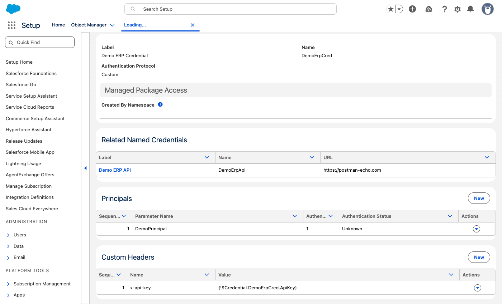
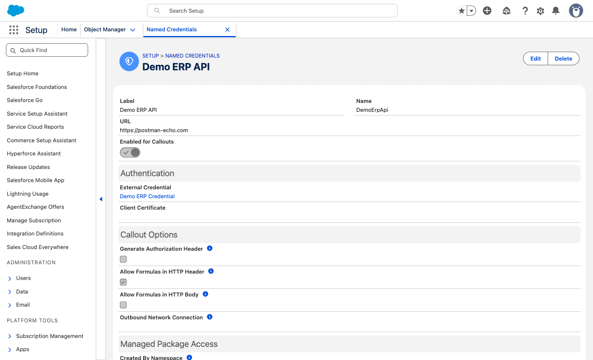
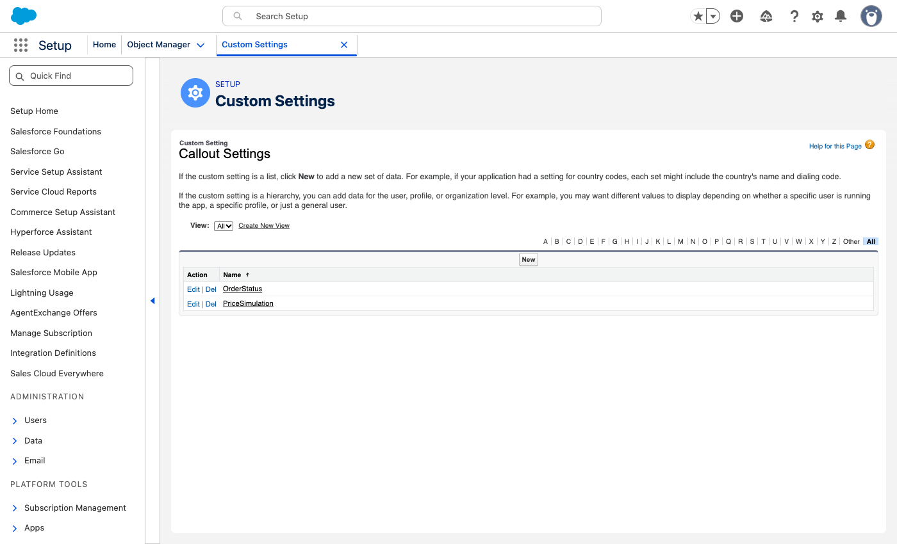
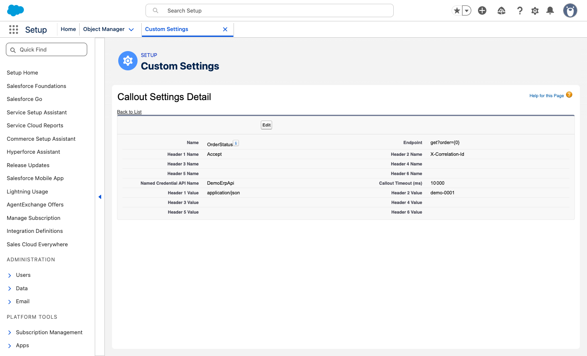

# apex-http-callout

A small Apex framework for outbound HTTP callouts. Each callout is configured by a record of the `CalloutSettings__c` custom setting: endpoint, Named Credential, timeout and static headers. Apex code then makes the call with one line. Logging with [Nebula Logger](https://github.com/jongpie/NebulaLogger) is optional and chosen at deploy time.

## Credits

This framework was designed and written by **Nicolas Greard**. This repo packages that work as a standalone, reusable project.

## How it works

`HttpRequestUtils.getHttpResponse(settingName, endpointParams, method, body, loggingMessage)`, with an optional sixth parameter `requestHeaders`:

1. Reads the `CalloutSettings__c` record named `settingName`. If there is none, throws `HttpRequestUtils.CalloutConfigException`.
2. Builds the endpoint. If `endpointParams` is given, `Endpoint__c` is a template with `{0}`, `{1}`... placeholders filled by `String.format`.
3. Sets headers from the `Header1__c`/`Value1__c` to `Header6__c`/`Value6__c` pairs. Pairs with a blank header name are skipped. Then sets the `requestHeaders`, if any: a header given there replaces a record header with the same name.
4. Sets the timeout from `Timeout__c`, kept within what Apex accepts (see [Configure a callout](#configure-a-callout)), and the method from `method`. The body is only set when the method is `POST`.
5. Sets the final URL:
   - `NamedCredentialApiName__c` blank: `Endpoint__c` is used as a full URL, which needs a Remote Site Setting.
   - `NamedCredentialApiName__c` set: `callout:<NamedCredential>/<Endpoint__c>`.
6. Sends the request and returns the `HttpResponse`:
   - Status below 400: returned. Logged at FINE when Nebula is on.
   - Status 400 or above: returned. The method does **not** throw; the caller checks the status code. Logged at ERROR with the tag `Callout: <settingName>` when Nebula is on.
   - `CalloutException` (timeout, DNS, TLS...): logged at ERROR when Nebula is on, then rethrown.
7. Keeps the request so that `HttpRequestUtils.getLastHttpRequest()` can return it, for example to log it from the caller. This also works in a `catch` block after a `CalloutException`: it returns the request that failed.

## Contents

| Path | What it is |
| --- | --- |
| [HttpRequestUtils.cls](force-app/main/default/classes/HttpRequestUtils.cls) | The framework class |
| [HttpRequestUtilsTest.cls](force-app/main/default/classes/HttpRequestUtilsTest.cls) | Unit tests with an `HttpCalloutMock`. They pass with and without Nebula. |
| [CalloutSettings__c](force-app/main/default/objects/CalloutSettings__c) | List custom setting: one record per callout, with the **All Callouts** list view |
| [scripts/deploy.sh](scripts/deploy.sh) | Deploys with or without [Nebula Logger](https://github.com/jongpie/NebulaLogger) |

## Guided tour

A complete example, set up in a demo org with fake data. The "ERP API" is [postman-echo.com](https://postman-echo.com), a public service that sends back what it receives, so you can see exactly which headers reach the API.

### 1. The External Credential holds the secret

The External Credential **Demo ERP Credential** (`DemoErpCred`) uses the **Custom** authentication protocol. Its principal `DemoPrincipal` stores a parameter `ApiKey`, encrypted. A custom header `x-api-key` references it with `{!$Credential.DemoErpCred.ApiKey}`: the key itself never appears in Setup, in Apex or in `CalloutSettings__c`.



Then give access to the principal: in a permission set, open **External Credential Principal Access**, add `DemoErpCred - DemoPrincipal`, and assign the permission set to the users who run the callout.

### 2. The Named Credential points to the API

The Named Credential **Demo ERP API** (`DemoErpApi`) holds the base URL and uses the External Credential. **Allow Formulas in HTTP Header** is checked, so that `{!$Credential.DemoErpCred.ApiKey}` is replaced by the key when the callout is sent. **Generate Authorization Header** is not needed: this API takes its key in `x-api-key`.



### 3. One CalloutSettings__c record per callout

Setup > Custom Settings > Callout Settings > **Manage**. The **All Callouts** list view, deployed with the repo, shows each callout's Named Credential, endpoint, timeout and header names. Header values are left out on purpose. Here, two callouts use the same Named Credential:



`OrderStatus` adds the path `get?order={0}`, a 10-second timeout and two non-secret headers. The API key is not here: it comes from the External Credential.



### 4. Call it from Apex

```apex
HttpResponse res = HttpRequestUtils.getHttpResponse('OrderStatus', new List<String>{ '00012345' }, 'GET', '', 'order: 00012345');
System.debug(res.getStatusCode() + ' ' + res.getBody());
```

The echo service shows what was sent (response trimmed):

```json
{
  "args": { "order": "00012345" },
  "headers": {
    "accept": "application/json",
    "x-correlation-id": "demo-0001",
    "x-api-key": "demo-key-123"
  },
  "url": "https://postman-echo.com/get?order=00012345"
}
```

- `{0}` in `Endpoint__c` was replaced by `00012345`.
- `Accept` and `X-Correlation-Id` came from the `OrderStatus` record.
- `x-api-key` came from the External Credential, with the stored key. Without **Allow Formulas in HTTP Header**, the API receives the text `{!$Credential.DemoErpCred.ApiKey}` instead.

A POST with a JSON body works the same way, with the `PriceSimulation` record:

```apex
HttpResponse res = HttpRequestUtils.getHttpResponse('PriceSimulation', null, 'POST', JSON.serialize(new Map<String, Object>{ 'sku' => 'DEMO-42', 'quantity' => 3 }), '');
// 200, the echo service returns "json": { "quantity": 3, "sku": "DEMO-42" }
```

A typo in the setting name fails with a clear message:

```apex
HttpRequestUtils.getHttpResponse('OrderStatsu', null, 'GET', '', '');
// HttpRequestUtils.CalloutConfigException: No CalloutSettings__c record named "OrderStatsu"
```

## Org setup

Salesforce blocks every outbound callout until the target is authorized. Set up one of the two options below before creating `CalloutSettings__c` records.

### Option 1: Named Credential (recommended)

1. Create an **External Credential** with the authentication protocol of the API (OAuth 2.0, Custom, AWS Signature...), and a principal that holds the secret.
2. Create a **Named Credential** that points to the base URL of the API and uses that External Credential.
3. Give the users who run the callout access to the principal: in a permission set, add the External Credential principal under **External Credential Principal Access**, then assign the permission set. This includes the integration user and the Automated Process user if the callout runs from a platform event, a flow or a scheduled job. Without this access, the callout fails with a credential error even though the setup looks correct.
4. Set `NamedCredentialApiName__c` to the Named Credential API name, and `Endpoint__c` to the path only.

The secret is encrypted and never visible in Apex, in the custom setting or in the logs. The base URL can differ in each org, so the same `CalloutSettings__c` records work in a sandbox and in production.

### Option 2: full URL with a Remote Site Setting

Leave `NamedCredentialApiName__c` blank and put the full URL in `Endpoint__c`. Then add the scheme and host (for example `https://api.example.com`) in Setup > Security > **Remote Site Settings**. Without it, the callout fails with `Unauthorized endpoint, please check Setup->Security->Remote site settings`. A Named Credential does not need a Remote Site Setting.

### On the target system

- Callouts come from Salesforce IP addresses. If the API or its firewall accepts only known IPs, allowlist the Salesforce IP ranges for your org's instance (Salesforce Help: "Salesforce IP Addresses and Domains to Allow").
- Callouts can only use ports 80, 443, and 1024 to 65535.
- The server certificate must be valid and trusted by Salesforce. For mutual TLS, upload the client certificate in Certificate and Key Management, then select it on the Named Credential.

### Apex rules for callouts

- **No callout after DML in the same transaction.** Doing so fails with `You have uncommitted work pending`. Make the callout first, or move it to a Queueable that implements `Database.AllowsCallouts`.
- **No synchronous callout from a trigger.** Use `@future(callout=true)` or a Queueable that implements `Database.AllowsCallouts`.
- **Limits per transaction:** 100 callouts and 120 seconds of total callout time. The response counts toward the heap limit, which is 6 MB synchronous and 12 MB asynchronous.
- **Tests cannot make real callouts.** Use `Test.setMock(HttpCalloutMock.class, ...)`, as [HttpRequestUtilsTest.cls](force-app/main/default/classes/HttpRequestUtilsTest.cls) does.

## Configure a callout

Create one `CalloutSettings__c` record per external endpoint: Setup > Custom Settings > Callout Settings > Manage.

| Field | Meaning |
| --- | --- |
| `Name` | Key used in Apex, e.g. `OrderStatus` |
| `NamedCredentialApiName__c` | Named Credential API name. Leave blank to use a full URL in `Endpoint__c`. |
| `Endpoint__c` | Path after the Named Credential, or a full URL. May contain `{0}`, `{1}`... |
| `Timeout__c` | Timeout in milliseconds, from 1 to 120000 (the Apex limits). Blank, 0 or negative: 5000 is used. Above 120000: 120000 is used. When Nebula is on, both cases are logged as a warning. |
| `Header1__c` ... `Header6__c` | Header names, e.g. `Content-Type` |
| `Value1__c` ... `Value6__c` | Value for the header with the same number |

Example with the Salesforce CLI:

```bash
sf data create record --sobject CalloutSettings__c --target-org mySandbox \
	--values "Name=OrderStatus NamedCredentialApiName__c=ErpApi Endpoint__c='orders/{0}/status' Timeout__c=10000 Header1__c=Accept Value1__c=application/json"
```

Custom setting records are data: they are not deployed with the metadata. Load them in every org, and again after a sandbox refresh if the values differ per environment.

### Where to put each header

| Header | Where | Why |
| --- | --- | --- |
| Credentials: `Authorization`, API keys, subscription keys, tokens, signatures | **External Credential**: its authentication protocol, or a custom header whose value references a principal parameter, e.g. `{!$Credential.ErpApiCred.ApiKey}`. The reference is only replaced by the secret when **Allow Formulas in HTTP Header** is checked on the Named Credential; otherwise the text `{!$Credential...}` itself is sent. | Encrypted, never visible in Apex, in the custom setting or in the logs. Who can use it is controlled by permission sets through the principal. |
| Non-critical headers shared by every endpoint of the API: `X-Tenant`, `X-Api-Version`, `User-Agent`... | **Named Credential**: custom header | Set once instead of in every `CalloutSettings__c` record. Named Credentials are metadata, so these headers can be deployed and versioned, unlike custom setting records. |
| Non-critical headers specific to one endpoint: `Content-Type`, `Accept`, `SOAPAction`... | **`CalloutSettings__c`**, `Header*__c` / `Value*__c` | Set per callout: a Named Credential header applies to every callout that uses it. Also the only place for headers when the callout uses a full URL instead of a Named Credential. A record header replaces a Named Credential header with the same name, so a record can override a shared header for one endpoint. |
| Non-critical headers whose value changes on each request: `Idempotency-Key`, `X-Correlation-Id`, `X-Request-Id`... | **Apex**: the `requestHeaders` parameter | The value is only known when the call is made. A header given there replaces a record header with the same name. Never pass a credential there. |

Do not put secrets in `Value*__c`: they are stored in plain text and visible to admins and in data exports. They are masked in the logs (see [Sensitive data in the logs](#sensitive-data-in-the-logs)), but that does not protect them anywhere else.

#### Same header in several places

Tested on API version 68.0 with an echo endpoint. When the same header name is defined in more than one place, only one value is sent, chosen in this order:

1. **Apex**: `requestHeaders`, then `CalloutSettings__c` headers, both set with `req.setHeader`
2. **Named Credential** custom header
3. **External Credential** custom header

So a `Header*__c` in `CalloutSettings__c` silently **replaces** a header with the same name on the Named Credential or the External Credential, `Authorization` included.

- For a credential header, this is a mistake: the secret is replaced by the plain-text value. Never configure in `CalloutSettings__c` a header that carries a credential.
- For a non-critical header shared on the Named Credential, such as `X-Api-Version`, this can be intended: one record overrides it for one endpoint.

Named Credential and External Credential custom header values are sent exactly as typed: do not wrap a literal in quotes.

## Call it from Apex

```apex
// GET https://<ErpApi>/orders/00012345/status
HttpResponse res = HttpRequestUtils.getHttpResponse('OrderStatus', new List<String>{ orderNumber }, 'GET', '', 'order: ' + orderNumber);
if (res.getStatusCode() == 200) {
	OrderStatus status = (OrderStatus) JSON.deserialize(res.getBody(), OrderStatus.class);
}

// POST with a JSON body, no endpoint parameters
HttpResponse res = HttpRequestUtils.getHttpResponse('PriceSimulation', null, 'POST', JSON.serialize(payload), '');

// Same, with a header whose value changes on each request
HttpResponse res = HttpRequestUtils.getHttpResponse('PriceSimulation', null, 'POST', JSON.serialize(payload), '', new Map<String, String>{ 'Idempotency-Key' => key });
```

`loggingMessage` is added to the Nebula log message after the setting name. Use it to identify the business record, e.g. `'order: ' + orderNumber`.

Errors to handle in the caller:

- Status 400 or above is returned, not thrown: check `res.getStatusCode()`.
- `System.CalloutException` is rethrown: catch it if the transaction must continue.
- An unknown setting name throws `HttpRequestUtils.CalloutConfigException`, whose message names the missing setting. This is a configuration error: it is not a `CalloutException`.

## Nebula Logger (optional)

Every [Nebula Logger](https://github.com/jongpie/NebulaLogger) line in the sources is committed **commented out**, and starts with the marker `// [nebula] `:

```apex
// [nebula] Logger.error(settingName + ' ' + loggingMessage).setHttpRequestDetails(req).setHttpResponseDetails(res).addTag('Callout: ' + settingName);
```

So the repo deploys to any org, with or without Nebula. [scripts/deploy.sh](scripts/deploy.sh) switches the lines on when asked:

| Command | Result |
| --- | --- |
| `scripts/deploy.sh -o <org>` | Deploys `force-app` as committed. No logging, no Nebula dependency. |
| `scripts/deploy.sh -o <org> --with-nebula` | Copies the project to `.build/` and removes the marker. Checks that the org has the `Logger` class, then deploys the copy. |
| `NEBULA_LOGGER=true scripts/deploy.sh -o <org>` | Same as `--with-nebula`, for CI pipelines |
| `scripts/deploy.sh --with-nebula --build-only` | Only writes `.build/force-app`, for a pipeline that deploys in its own way |

Anything after `--` is passed to `sf project deploy start`:

```bash
scripts/deploy.sh -o mySandbox --with-nebula -- --test-level RunSpecifiedTests --tests HttpRequestUtilsTest
scripts/deploy.sh -o myProd -- --dry-run --test-level RunSpecifiedTests --tests HttpRequestUtilsTest
```

The sources are never modified: `--with-nebula` works on the `.build/` copy, which git ignores.

Requirements for `--with-nebula`:

- The **unlocked** [Nebula Logger](https://github.com/jongpie/NebulaLogger) package (no namespace), v4.13.1 or later: `setHttpRequestDetails` and `setHttpResponseDetails` appeared in that version. The managed package (namespace `Nebula`) is not supported, because the code calls `Logger`, not `Nebula.Logger`.
- The caller must call `Logger.saveLog()`. `HttpRequestUtils` adds log entries but never saves them. If a `CalloutException` is rethrown and nobody catches it, the entries are lost.

What is logged when Nebula is on:

| Case | Level | Details |
| --- | --- | --- |
| Each header that is set | FINE | Header name. Value only for standard non-secret headers, `[masked]` otherwise (see below) |
| Status below 400 | FINE | Request (endpoint, method, body) and response |
| Status 400 or above | ERROR | Request and response, tag `Callout: <settingName>` |
| `CalloutException` | ERROR | Exception, request, tag `Callout: <settingName>` |
| Unknown setting name | ERROR | Name of the missing setting, tag `Callout: <settingName>`, then `CalloutConfigException` is thrown |
| Blank, zero, negative or too high `Timeout__c` | WARN | Configured value and the timeout used instead, tag `Callout: <settingName>` |

### Sensitive data in the logs

The header **name** is always logged. The header **value** is logged only if the header is in the list below, which is hardcoded in `LOGGABLE_HEADERS` in [HttpRequestUtils.cls](force-app/main/default/classes/HttpRequestUtils.cls). The value of every other header is logged as `[masked]`.

| Header values that are logged | Every other header value is logged as `[masked]`, for example |
| --- | --- |
| `Accept`, `Accept-Charset`, `Accept-Encoding`, `Accept-Language` | `Authorization`, `Proxy-Authorization` |
| `Cache-Control` | `Cookie` |
| `Content-Encoding`, `Content-Language`, `Content-Type` | `x-api-key`, `Ocp-Apim-Subscription-Key` |
| `User-Agent` | `X-Auth-Token`, `X-Signature` |
| `X-Correlation-Id`, `X-Request-Id` | Any custom header, such as `X-Tenant` |

Header names are compared without case and without surrounding spaces, so `content-type` and `Content-Type` are treated the same.

Design choices:

- **A list of safe headers, not a list of secret ones.** A header nobody thought of, such as `X-Partner-Secret`, is masked by default. If the list is incomplete, you lose a bit of debug information; you never leak a secret.
- **Hardcoded, not configurable.** The list cannot be changed in a custom setting or from Setup. Logging one more header value takes a code change, so it goes through code review and deployment. A configurable list would let anyone who can edit custom settings expose tokens in the logs, with no deployment and no review. It would also need a fallback in every org where the setting was not loaded.

To log the value of another non-secret header, add its name **in lower case** to `LOGGABLE_HEADERS`, add it to `standardHeaderValuesAreLoggable` in [HttpRequestUtilsTest.cls](force-app/main/default/classes/HttpRequestUtilsTest.cls), and update the table above. Never add a header that can carry a credential, a session or a signature.

If your code logs the request returned by `getLastHttpRequest()`, mask the header values the same way:

```apex
Logger.fine('Accept: ' + HttpRequestUtils.getLoggableHeaderValue('Accept', req.getHeader('Accept')));
```

The request **body** is still logged through `setHttpRequestDetails`. Do not send secrets in the body (for example an OAuth `client_secret`): let a Named Credential handle authentication.

### Adding a Nebula call

Write it on one line and start it with the marker, keeping the indentation:

```apex
		// [nebula] Logger.warn('Retrying ' + settingName);
```

Before deploying, the deploy script checks every `.cls` and `.trigger` file under `force-app` and stops if it finds a `Logger.` call that is not commented out. Without that check, the default deploy would fail in orgs that do not have Nebula.

## Deploy and test

Prerequisites: the [Salesforce CLI](https://developer.salesforce.com/tools/salesforcecli) (`sf`) and bash. The script works with the bash 3.2 that ships with macOS.

```bash
sf org login web --alias mySandbox
scripts/deploy.sh -o mySandbox
sf apex run test --class-names HttpRequestUtilsTest --target-org mySandbox --result-format human --code-coverage
```

For a scratch org, use `config/project-scratch-def.json`:

```bash
sf org create scratch --definition-file config/project-scratch-def.json --alias httpCallout --set-default
scripts/deploy.sh -o httpCallout
```

## Known limitations

The main points:

- The body is only sent for `POST`.
- Endpoint parameters are not URL-encoded.
- At most 6 headers per callout in `CalloutSettings__c`, plus any number in `requestHeaders`.
